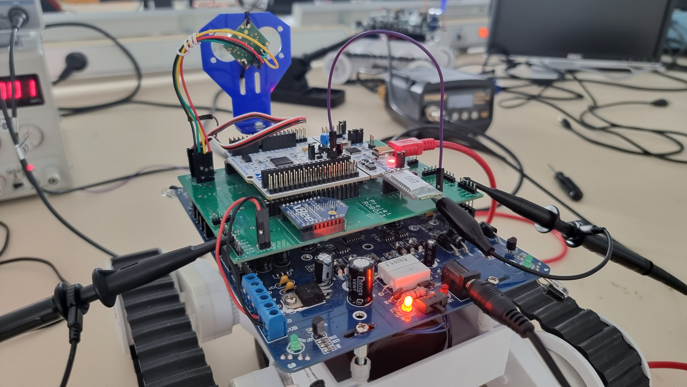
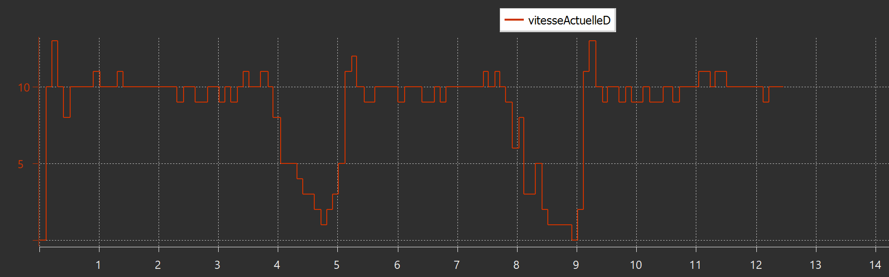
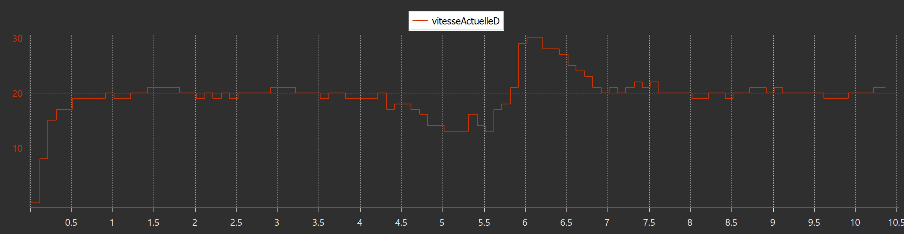
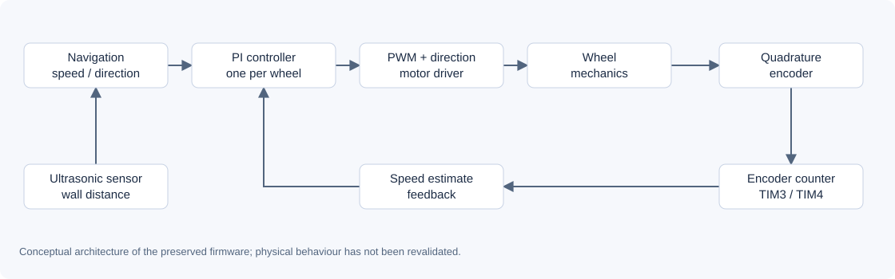

# Autonomous Robot with PI Speed Control

**Encoder feedback, independent wheel control and ultrasonic positioning on STM32.**

A robotics project I completed at **Mines Saint-Étienne** in **June 2024**, as part of the ISMIN *Microcontroller Systems 1* course. This repository presents my embedded implementation, controller-tuning experiments and the original CubeIDE project.

`Embedded C` · `STM32L476RG` · `PI control` · `PWM` · `Quadrature encoders` · `Ultrasonic sensing`

  

*Original project hardware during bench testing. The educational robot platform and carrier electronics were reused; this repository focuses on my firmware, integration and control work.*

## The project

The task was to move a two-wheel robot towards a predefined parking position using a wall as a positioning reference. The robot used an ultrasonic sensor for distance measurements and Hall-effect encoders for wheel-speed feedback. Separate PI controllers adjusted the two motor PWM commands.

The challenge was to connect motion sequencing, real-time measurements and motor control, then tune the controller against actual disturbances rather than relying only on an open-loop duty-cycle command.

## My work and skills demonstrated

**Author: Paul Guillemin.** I worked on the embedded implementation, peripheral integration, motion logic and experimental tuning of the robot.

| Work completed | Skills demonstrated |
| --- | --- |
| Configuring the STM32 peripherals and integrating the robot platform | STM32 HAL, GPIO, ADC, timers and interrupts |
| Driving the two motors independently | PWM generation, direction control and motor-driver interfacing |
| Reading encoder feedback and estimating wheel speed | Quadrature encoder mode, timer counters and unit conversion |
| Implementing and tuning the wheel PI controllers | Discrete feedback control, proportional/integral terms and disturbance response |
| Implementing wall-referenced motion sequencing | Ultrasonic measurements, state variables and timed turns |
| Recording bench measurements and controller responses | Oscilloscope measurements, debugging and experimental comparison |

The STM32 support libraries and UART retargeting helper are third-party components, credited in [THIRD_PARTY_NOTICES.md](THIRD_PARTY_NOTICES.md).

## Controller-tuning results

The preserved captures show the effect of controller settings on measured wheel speed. The PI response recovers towards its previous operating level after a disturbance, while the proportional-only experiment retains a lower steady operating level.

| Proportional-only experiment | PI tuning experiment |
| --- | --- |
|  |  |

These are **historical experimental captures**, not simulated or newly generated curves. Their original variable label, `vitesseActuelleD`, means *current right-wheel speed*. The captures were taken during separate experiments; the full acquisition configuration and raw time-series data are not available. I therefore do not present them as a new quantitative benchmark or claim zero overshoot.

Additional [tuning observations](docs/control-and-results.md) discuss higher-gain experiments and the difference between design targets and verified evidence.

## How it works

Each wheel controller follows the same basic sequence:

1. Read the encoder counter and estimate wheel speed.
2. Compute the difference between requested and measured speed.
3. Accumulate the error and form the PI command.
4. Update the motor PWM, while direction is handled separately.

The foreground navigation logic compares wall distance with target coordinates and sequences straight movements and timed turns. Timer callbacks perform wheel control and battery checks.

**The original firmware is preserved without functional changes.** It is a development snapshot, not a newly validated autonomous product. In particular, it starts a motor command during initialisation and contains unfinished navigation parameters and numerical limitations. See the [implementation notes](docs/technical-notes.md) before attempting a hardware run.

## Explore the repository

| Location | Contents |
| --- | --- |
| [firmware/](firmware/) | Complete STM32CubeIDE project, application C code, HAL/CMSIS dependencies, startup and linker scripts |
| [Controller and results](docs/control-and-results.md) | PI implementation, historical experiments and evidence limits |
| [Reproduction guide](docs/reproduction.md) | Build instructions, pin assignments and staged bench checks |
| [Implementation notes](docs/technical-notes.md) | Snapshot behaviour, configuration differences and known issues |
| [Provenance and verification](docs/validation.md) | Source selection and checks performed for this portfolio |
| [docs/media/](docs/media/) | Original hardware photographs, experimental captures and an explanatory diagram |

## Reproduce the build

1. In STM32CubeIDE, select **File → Import → General → Existing Projects into Workspace**.
2. Import `firmware/` as project **`projet_robot_rebuild`**.
3. Select **Debug**, then **Build Project**.

Verified on **19 October 2026** with **STM32CubeIDE 1.19.0** and **GNU Tools for STM32 13.3.rel1**: **0 errors, 0 warnings**. No board was flashed and no new robot run was performed during portfolio preparation.

## Limitations and possible next steps

- Controller gains and motion timing are specific to the original platform and experimental setup.
- The archive needs explicit command saturation, anti-windup and encoder wrap handling before robust reuse.
- Left and right speed calculations use different hard-coded time intervals; these need reconciliation with measured timing.
- Timed turns, zero-valued target coordinates and the startup motor command require review before a navigation trial.
- A future revision could add a safe arming sequence, calibrated speed estimation and repeatable tests with logged measurements. These improvements are not included in this snapshot.

## Author and timeline

**Paul Guillemin** — Mines Saint-Étienne, ISMIN engineering programme.

Original project: **June 2024**. Portfolio preparation: **19 October 2026**. New import commits use their actual creation dates; no historical development commits have been fabricated.

All portfolio documentation is in English. Original firmware comments, diagnostic messages and capture labels retain their original language. The complete academic report is not included in this repository.

No new repository-wide licence has been assigned. Original third-party notices are preserved in the firmware and summarised in the [credits](THIRD_PARTY_NOTICES.md).
